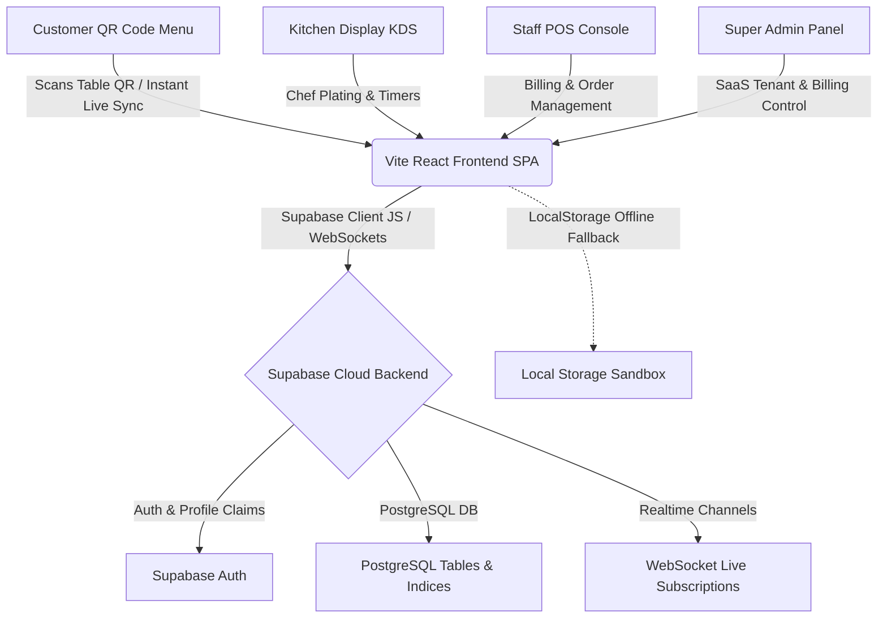

# 🏗️ RestaurantsOS Architecture & Developer Guide

This document provides a technical overview of the **RestaurantsOS** application architecture, state management flow, database design, caching strategy, and security model.

---

## 🗺️ 1. Architecture Overview
RestaurantsOS is built as a highly responsive Single Page Application (SPA) supporting real-time cloud data synchronization and low-latency client rendering.

---

## 🗄️ 2. Database Schema & Multi-Tenancy

### Core Tables (`schema.sql`)
1. **`restaurants`**: Central tenant configuration table (Name, Address, Logo, Currency, GST parameters, Subscription Plan: `starter`, `pro_6m`, `pro_1y`, Status: `trial`, `active`, `expired`, `suspended`).
2. **`users`**: Extended profile schema linked to `auth.users.id`. Roles: `admin`, `manager`, `cashier`, `kitchen`, `waiter`, plus `is_super_admin` flag.
3. **`tables`**: Physical dining tables (`id`, `number`, `capacity`, `status`, `qr_code_url`).
4. **`categories`**: Menu categories (`id`, `name`, `order`).
5. **`food_items`**: Dish configurations (`id`, `name`, `price`, `description`, `image`, `is_available`, `spicy_level`, `discount_percentage`).
6. **`orders`**: Customer checkout receipts (`id`, `order_number`, `table_name`, `items` JSON, `status`).
7. **`payments`**: Final invoices and tax transaction logs.
8. **`notifications`**: Real-time staff alerts.

---

## 🔄 3. State Management & Real-time Synchronization

### ⚡ Instant Menu Real-Time Sync
- **Subscriptions for All Sessions**: Both POS staff and customer QR menu sessions subscribe to `subscribeFoodItems` and `subscribeCategories` WebSocket channels.
- **0-Second Propagation**: Any dish addition, price edit, stock availability toggle, or deletion performed in `MenuManager.tsx` propagates **instantly in 0 seconds** to all connected customer screens without requiring a page refresh.
- **DELETE Event Optimization**: Supabase Realtime channel for `food_items` and `categories` listens to `DELETE` events without table filter restrictions, guaranteeing instant deletion handling even when default PK replica identity is used.

### 🔔 Sound & Voice Notification Guard
- **Strict Trigger Guard**: Notification bell chimes (synthesized on-device via Web Audio API) and text-to-speech announcements run **exclusively when a customer places a new order** during an active session. Speech/sound alerts do NOT trigger when a restaurant owner or staff member logs into the application.

---

## 🛡️ 4. Security & Access Control

### Super Admin Access Guard
- `<SuperAdminDashboard />` enforces an explicit authorization guard (`if (!currentUser?.isSuperAdmin)`). Unauthorized users are blocked and presented with a security notice.
- **1-Click Tenant POS Switcher**: Super Admin can switch active tenant context (`setRestaurantId(tenantId)`) to inspect or configure any onboarded restaurant. A banner allows 1-click return to the Super Admin Control Panel.

---

## 🚀 5. Cache Bypassing & Performance

1. **Edge CDN Headers (`vercel.json`)**: Configured with `Cache-Control: no-cache, no-store, must-revalidate` across application routes.
2. **HTML Meta Tags (`index.html`)**: Includes `Pragma: no-cache` and `Expires: 0` directives.
3. **Network-First Service Worker (`public/sw.js`)**: Forces network requests for application code and data (`cache: 'no-store'`), using cache only as an offline fallback.
4. **Universal Gourmet Cloche Animation (`PageLoader.tsx`)**: Reusable vector SVG animation depicting a gourmet cloche dome lifting with rising steam, standardizing loading UX across initial startup, Suspense fallbacks, and tab transitions.
