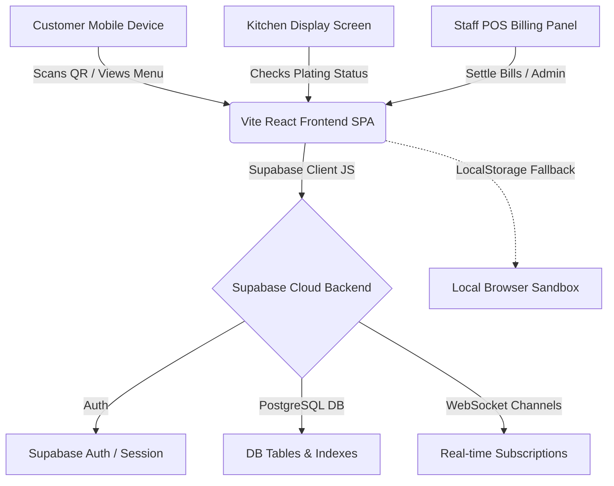

# 🏗️ RestaurantsOS Architecture & Developer Guide

This document provides a comprehensive technical overview of the **RestaurantsOS** application codebase, state management flow, database design, and core feature implementations for developers and maintainers.

---

## 🗺️ 1. Architecture Overview
RestaurantsOS is built as a highly responsive Single Page Application (SPA) that supports two operational models:
1. **Cloud Sync Mode (Supabase)**: Real-time, multi-device sync utilizing PostgreSQL databases, Row Level Security (RLS) policies, and WebSockets (Supabase Realtime).
2. **Local Demo Mode (LocalStorage Fallback)**: A zero-config fallback that synchronizes multiple browser tabs in real time on the same device using standard HTML5 LocalStorage and custom event notifications.



---

## 🗄️ 2. Database Schema & Data Models
All database models are located under `src/types/index.ts` and initialized via `schema.sql`.

### Core Tables
1. **`restaurants`**: Central tenant configuration table for SaaS restaurants.
   - Holds company meta (name, address, logo, currency, GST parameters) and subscription metadata (plan types: `starter`, `pro_6m`, `pro_1y`, and `plan_expiry_date`).
2. **`users`**: Extended profile schema for restaurant employees linked directly to Supabase Auth (`auth.users.id`).
   - Stores account credentials and role levels (`admin`, `manager`, `cashier`, `kitchen`, `waiter`).
3. **`tables`**: Physical restaurant dining tables.
   - Fields: `id`, `number` (identifier), `capacity`, `status` (`available`, `occupied`, `reserved`), and `qr_code_url`.
4. **`categories`**: Menu groups (e.g. *Beverages, Appetizers, Desserts*).
   - Fields: `id`, `name`, `order` (for user-controlled sorting layout).
5. **`food_items`**: Dish configurations.
   - Fields: `id`, `name`, `price`, `description` (with variant overrides), `image`, `is_available`, `spicy_level`, and `discount_percentage`.
6. **`orders`**: Customer checkout receipts.
   - Fields: `id`, `order_number`, `table_name`, `items` (JSON payload of ordered food), `status` (`pending`, `accepted`, `preparing`, `ready`, `served`, `completed`), and price calculations (`subtotal`, `tax`, `grand_total`).
7. **`payments`**: Final invoices and tax reports.
   - Tracks cashouts, totals, discounts, and payment methods (`cash`, `card`, `upi`, `wallet`).
8. **`notifications`**: Real-time staff notifications for waiter calls and bill requests.

### Performance Indexes
For massive enterprise scaling, the database uses 13 custom indices on foreign keys and compound querying fields:
* `idx_users_restaurant_id` / `idx_tables_restaurant_id` / `idx_orders_restaurant_id` (enforces instant multi-tenant separation).
* `idx_orders_status` (speeds up active kitchen/waiter Kanban dashboards).
* `idx_orders_created_at` (orders historical reports query index).

---

## 🔄 3. State Management & Real-time Flow
State management is centralized inside [RestaurantContext.tsx](file:///Users/sahildholpuria/Documents/Digital%20Order%20Management%20for%20Restaurants/src/context/RestaurantContext.tsx).

### Data Subscription Strategy (Free-Plan Friendly)
To prevent rate-limiting or exceeding active connection thresholds on Supabase's Free Tier, RestaurantsOS runs a **dynamic client subscription router**:
* **Guest Customers**: Only subscribe to a single row-specific stream to track their specific order status changes. They do not subscribe to KDS updates, notifications, or store revenue.
* **Kitchen / Waiters**: Only subscribe to active `orders` and `notifications` logs.
* **Administrators / Cashiers**: Open channels to `orders`, `notifications`, and `payments` tables.
* **Static Assets**: Tables like `food_items` and `categories` are fetched as a single REST request on page load and cached locally instead of maintaining persistent WebSocket connections.

### Audio alerts & Voice Announcements
When a new order or waiter request is broadcasted, the staff dashboard handles notification audio:
1. **Web Audio API Sequence**: Synthesizes a high-fidelity 4-note bell chime directly on the browser tab (using custom AudioNode sine oscillators) to avoid downloading heavy audio media assets.
2. **Text-to-Speech API**: Calls the browser's native SpeechSynthesis window to verbally call out the ticket: *"New order for Table 4 received."*

---

## 🛠️ 4. Key Feature Walkthroughs

### portion Pricing (Half/Full)
Dish variants are encoded directly inside the food item's `description` field using a structural suffix parser:
```
Description text ||variants:Half=150;Full=280
```
* **How it works**: The parser splits the string on the double-pipe (`||variants:`). It generates selectable buttons in the UI for the customer, recalculates cart item prices dynamically, and safely saves the custom size and price to the order receipt payload.

### Secure Table Status Transitions
1. **Order Checkouts**: When a customer orders, the table updates to `occupied`.
   - *Security note*: Direct public write is disabled. The client triggers the update securely via a custom PostgreSQL RPC function `update_table_status(p_table_id, p_status)` which runs with `security definer` privileges, avoiding direct table edit exposure.
2. **Bill Settlement**: When a cashier settles a table, the system sets the order to `'completed'`. 
   - A handler checks if there are any remaining unpaid active orders on the same table. If no other orders are open, it automatically marks the table status back to `available`.

### Expiry Lockout Scrim
Inside [App.tsx](file:///Users/sahildholpuria/Documents/Digital%20Order%20Management%20for%20Restaurants/src/App.tsx), a central check verifies `plan_expiry_date` against the current timezone-safe local date on dashboard entry:
- If expired, it triggers a full-screen glassmorphic lockout overlay, blocking route changes and dashboard access while offering a direct billing logout action.

---

## 🎨 5. Styling & Visual Polish
* **Tailwind CSS v4**: Built entirely with customized premium layout tokens. Use variables defined in `tailwind.config.js` or `index.css` for consistent styling.
* **Glassmorphic Toasts & Modals**: Built custom responsive alerts in place of browser defaults (`alert()`, `confirm()`) for premium UX styling.
* **Dark Mode**: All screens inherit adaptive tailwind classes (`dark:bg-slate-900`, `dark:text-slate-100`) and automatically respond to client theme settings.
